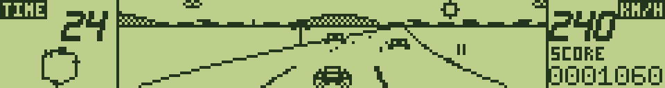
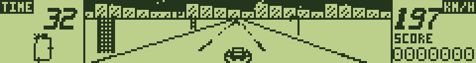

# ポケレーサー

後ろから見た道を走るレースゲーム（疑似 3D）です。車を 3 台から選び、8 つのステージ（どれも 1 周の周回コース）を走ります。アイテム、得点、ハイスコアの名前入れがあります。画面の字はすべて英語で、自分で描いたフォントです。遊び方は [POKERACE_MANUAL.txt](POKERACE_MANUAL.txt) にあります。

| キー | 働き |
|---|---|
| SPACE | 始める、決める |
| ◀ ▶ | ハンドル、選ぶ |
| ▼ | ブレーキ（アクセルは自動） |
| ON/BRK | BASIC に戻る |

RAM 32 KB の機種で、機械語エリア 26 KB（`B9400h`〜`BFBFFh`）に入ります。プログラムは 26,434 バイト、残る BASIC の空きは約 2 KB です（エミュレータで `FRE 0` が 1976）。

## ファイル

| ファイル | 内容 |
|---|---|
| [pokerace.asm](pokerace.asm) | 本体: 流れ、ステージと車の表、コース、変数 |
| [screens.inc](screens.inc) | タイトル（ロゴ、自動で走る、ランキング）、車の選択、ステージの紹介、集計、GAME OVER、エンディング、名前入れ |
| [race.inc](race.inc) | 走る処理: キー、車の性能、進む、ほかの車、アイテム、チェックポイント、ゴール、得点、自動運転 |
| [road_draw.inc](road_draw.inc) | 道（路肩、車線の線） |
| [objects.inc](objects.inc) | 道ばたの物 7 種類（松、ヤシ、サボテン、ビル、街灯、柵、岩）、ゲート、ほかの車、アイテム、自分の車、ターボの線 |
| [hud.inc](hud.inc) | 字（自分のフォント）、数を字にする、計器 |
| [lcd_fast.inc](lcd_fast.inc) | 仮想画面を LCD に送る |
| [sound.inc](sound.inc) | ブザーで曲を鳴らす（タイトル、ステージの始まり、クリアなど） |
| [make_data.py](make_data.py) | 下のデータを作る（`python make_data.py`） |
| `font_s.bin`、`font_b.bin`、`font_m.bin` | 字（小 5 × 7、大 9 × 14 の斜体、計器の数字 7 × 11 の斜体） |
| `title.bin` | タイトルの絵 |
| `car0〜2.spr`、`car_big.bin` | 自分の車 3 台（12 コマずつ）、選ぶ画面の大きい車 |
| `rival_*.spr`、`item_*.spr`、`dust.spr` | ほかの車（2 車種 × 4 段）、アイテム（4 種類 × 3 段）、砂ぼこり |
| `sky0〜7.bin` | ステージごとの空 |
| [stages.inc](stages.inc) | ステージの表、コース、コースの図（進み具合の段ごとの位置） |
| [road.inc](road.inc)、[text.inc](text.inc)、[sound_data.inc](sound_data.inc) | 道の表、文字列と計器の札、曲 |
| [pokerace.e500test.json](pokerace.e500test.json) | テスト（28 件） |

## コースと現在地

左の計器の下に、コースの図（40 × 24 ドット）を出し、いまいる所を点滅する 3 × 3 の四角で示します。× 印がスタートとゴール、+ 印がチェックポイントです。

- どのステージも、1 周がステージの長さちょうどの周回コースです。`make_data.py` が、右回りの角（合計 360°）で凸多角形を作り、辺に S 字を入れ、辺のまっすぐの長さを、周回が閉じて 1 周がステージの長さになるように連立方程式で決めます。ゲームで感じるカーブと図の形は同じデータから来ています。
- 図は、ステージの進み具合を 38 段に分けた位置（x、y）だけを持ち、走り出す前にプログラムが点を線でつないで描きます（真ん中で分けていく描き方）。
- コースの表は 1 区間 2 バイト（長さ ÷ 128、カーブ）です。

## 字

ROM の字形は使わず、4 種類の字を `make_data.py` で 1 字ずつ描いています。形は「角を落とした四角」でそろえ、大きい字と計器の数字は太さ 2 ドットの斜体です。英語版の機種でも同じ字が出ます。

| 字 | 大きさ | 使う所 |
|---|---|---|
| 小 | 5 × 7 | メニュー、得点、知らせ。丸い字は角を 1 ドット落とし、0 は点入り |
| 大 | 9 × 14 を斜体（12 × 16 の升） | STAGE 1、GOAL!、車の名前、名前の入力。横線は 0〜1、6〜7、12〜13 行にそろえる |
| 計器の数字 | 7 × 11 を斜体 | 時間と速さ |
| 札 | 3 × 5 | 計器の見出し。TIME、KM/H、TURBO は黒地に白抜き |

タイトルのロゴは、小さい字を AdvMAME3x で 3 倍にし、斜体、白い横線、影を付けています。

## 音

ブザーは SCR のビット 4〜6 で鳴らします（[解析 10 章](https://github.com/litchi-gh/pc-e500_tools/blob/main/docs/analysis/10_SYSTEM.md)）。

- **曲**: 1 音ずつ、SCR のビット 4 を自分の周期で反転して鳴らします（`sound.inc`）。その間はゲームが止まるので、曲はタイトルや画面の切り替えの所だけです。タイトルの曲は 1 音ごとにキーを見ます。
- **効果音**: 「種類、コマ数」の列を 1 コマに 1 つ進めます（`race.inc` の `sfx_*`）。2 kHz、4 kHz はブザーが自分で鳴るので、ゲームを止めません。
- **エンジンの音**: 1 コマに 40 回ほど呼ばれる `tick_poll` で、`eng_acc += eng_step` があふれるたびにビット 4 を反転します。高さは 30 + 速さ ÷ 2（ターボ中は + 50、道の外では乱数でゆれる）。呼ばれる間隔がふぞろいなので、少しざらついた音になります。

## 速さ

1 コマは 16 ミリ秒のタイマ 3 回（48 ミリ秒、1 秒に約 20 コマ）を目安にしています。重いコマは 4 回になり、そのコマの進む量と時間はタイマの回数で合わせます（1 コマの進む量 = km/h ÷ 4 × タイマの回数）。

| 方法（1 画面 960 バイトを LCD に送る） | サイクル |
|---|---|
| IOCS `SCRN_ROW_WRITE` × 4 行 | 24057 |
| IOCS `SCRN_DOTS_WRITE` × 960 | 約 1060000 |
| 直接、1 バイトずつのループ | 16442 |
| 直接、7 バイトずつ展開、左から右の所は `POPU A` で読む（実機では崩れる） | 9692 |

エミュレータで数えた値です。LCD に直接書くほうが速いので、IOCS は使いません。

LCD コントローラは 1 バイト受け取るとしばらく BUSY になり、その間に来たデータを捨てます。実機（PC-E650）で試すと、データを書く間隔が 6、8、10 サイクルでは取りこぼし、14 サイクルでは取りこぼしませんでした。そこで、1 バイトずつのループで 14 サイクル以上あけて書いています（`lcd_fast.inc` の `put_fwd`、`put_rev`）。エミュレータは BUSY を真似しないので、エミュレータでは間隔が短くても崩れません。このため、間隔をあける前より 1 秒あたりのコマ数が 1 割ほど減りました（タイトルのデモ走行で約 24 から約 21）。

ほかに次のことをしています。

- 毎コマ送るのは道の所（x = 43〜196）だけです。計器は変わった行だけを送り、描き直すのも 1 コマに 1 か所（時間、速さ、得点、コースの図の順）です。
- LCD のアドレスは `0A00xh` 台を使います。LCD は A0〜A3、A12、A13 だけを見るので `2000h` 台と同じコントローラに届きます。`2000h`〜`3FFFh` は CPU が LCD の窓として 1 回 7 ステートに遅くする範囲で、`0A00xh` は ROM が表示に使っているアドレスです（[解析 4 章](https://github.com/litchi-gh/pc-e500_tools/blob/main/docs/analysis/04_LCD.md)、[2 章](https://github.com/litchi-gh/pc-e500_tools/blob/main/docs/analysis/02_CPU.md)）。エミュレータはこの待ちを数えません。
- 内部 RAM は BP = 0 にして `(BP+n)` の形で使います（`(n)` の形より 1 サイクル少ない）。
- 道ばたの物は縦線（液晶の縦 8 ドットのバイト）を左右 2 列ずつまとめて描きます。

## 変えてみる

| 変えること | 場所 |
|---|---|
| ステージの時間、区間の数と長さ、ほかの車の速さ、道ばたの物 | `make_data.py` の `STAGES` |
| コース | `make_data.py` の `STYLE`（角の数とカーブ、S 字の数とカーブ）。作り直すと図も変わる |
| 車の性能 | `car_tab`（最高速度、加速、ハンドル、すべり） |
| アイテムの出方 | `race.inc` の `item_spawn` |
| 字、車、空、曲、文字列 | `make_data.py` を直して実行 |
