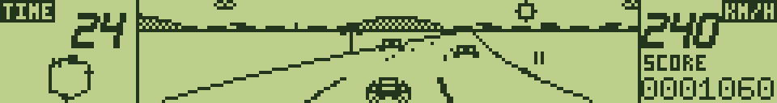
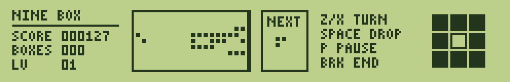

# PC-E500 ゲーム集

SHARP PC-E500 シリーズ（PC-E500、PC-E500S、PC-E650 など）で動くゲームを集めました。機械語のゲームと BASIC のゲームがあります。どれも [PC-E500 開発ツール](https://github.com/litchi-gh/pc-e500_tools)で作り、そのエミュレータで確かめています。

シャープとは関係のない、個人のプロジェクトです。

## 機械語

| 画面 | ゲーム | 内容 | 大きさ |
|---|---|---|---|
|  | [ポケレーサー](Assembler/PokeRacer/README.md) | 後ろから見た道を走るレースゲーム。車 3 台、8 ステージ、アイテム、コースの図。RAM 32 KB 以上 | 26,469 バイト |
|  | [ナインボックス](Assembler/NineBox/README.md) | 3 × 3 のマスを埋めて消すパズル | 9,336 バイト |
|  | [スターキャッチ](Assembler/StarCatch/README.md) | 敵をよけて星を取る | 約 5 KB |
|  | [メテオ](Assembler/Meteor/README.md) | 飛んでくる隕石を撃つ | 約 5 KB |

## BASIC

| 画面 | ゲーム | 内容 |
|---|---|---|
|  | [スターランナー](BASIC/StarRunner/README.md) | 流れてくる隕石をよけながら進む |
|  | [数当て](BASIC/HighLow/README.md) | 1〜100 の数を当てる |
|  | [反応速度](BASIC/Reflex/README.md) | 音が鳴ったら、すぐに SPACE を押す |
|  | [歩く人](BASIC/Walker/README.md) | テンキーで人を動かす |

## 遊び方

| したいこと | 方法 |
|---|---|
| エミュレータで遊ぶ | VS Code に拡張機能「PC-E500 開発ツール」を入れ、このフォルダを開き、`.asm` か `.BAS` を開いて `F5` |
| 実機で遊ぶ | 機械語のゲームは BIN を、BASIC のゲームは `.BAS` を送る（[実機へ送る](https://github.com/litchi-gh/pc-e500_tools/blob/main/docs/manual/14_TRANSFER.md)）。ポケレーサーとナインボックスは BIN 付き。スターキャッチとメテオは `e500 bin 名前.asm`（VS Code では「PC-E500: BIN を作成」）で作る。機械語エリアを確保する行、`LOAD M`、`CALL` の行は `e500 bin` が表示する |
| テストを流す | コマンド `e500` で `e500 test .`（機械語のゲームにテストが付いています） |

`.asm` が使う INCLUDE ファイル（`game.inc`、`screen.inc` など）は、拡張機能とコマンド `e500` に入っています。拡張機能の入れ方は [pc-e500_tools のインストール](https://github.com/litchi-gh/pc-e500_tools/blob/main/docs/manual/02_INSTALL.md)にあります。

## ライセンス

[MIT](LICENSE)
